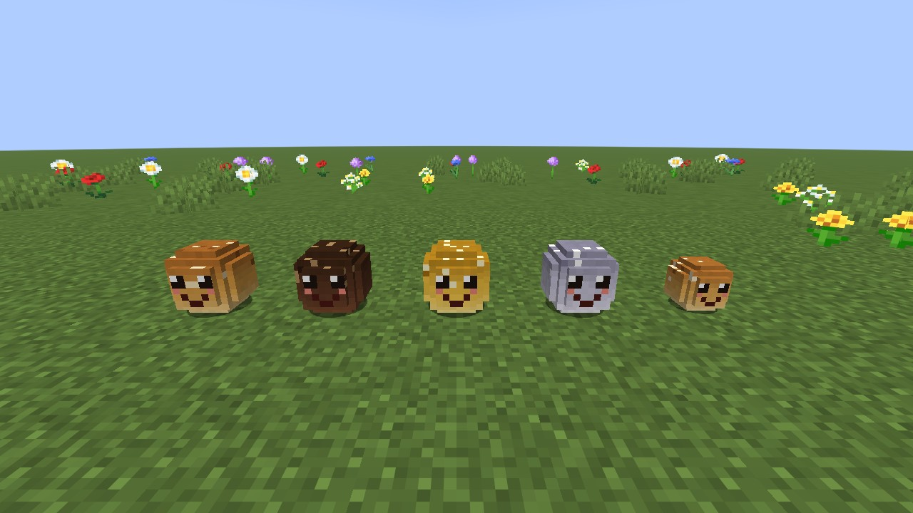
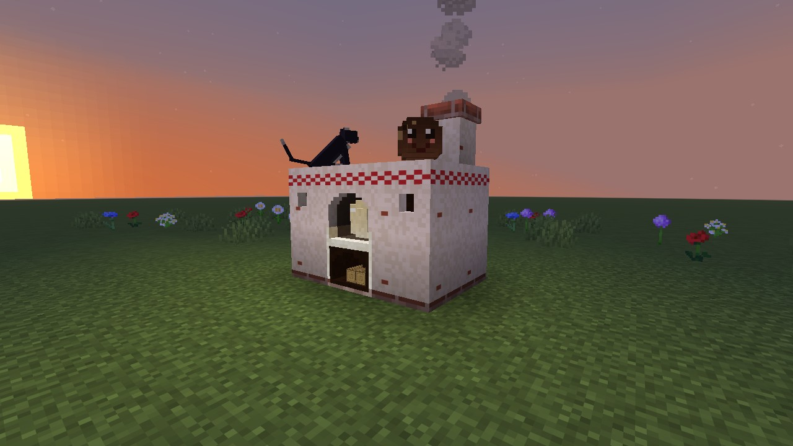
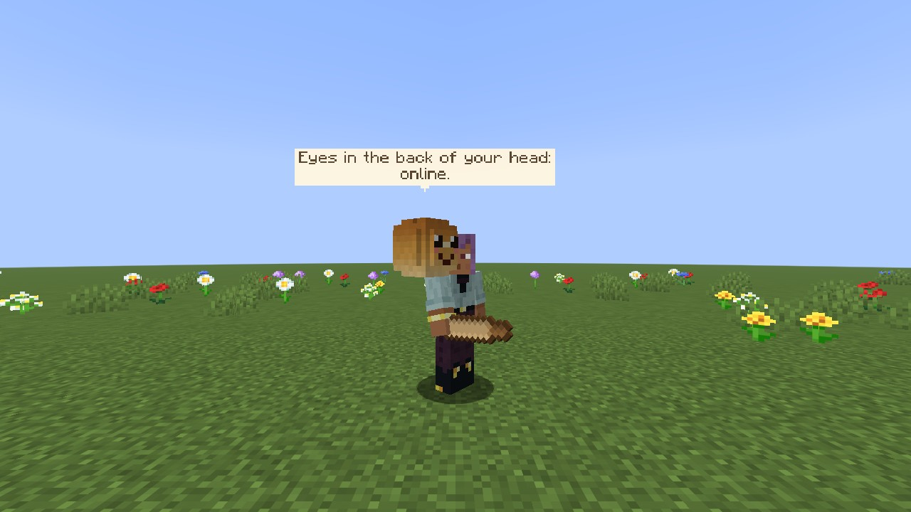
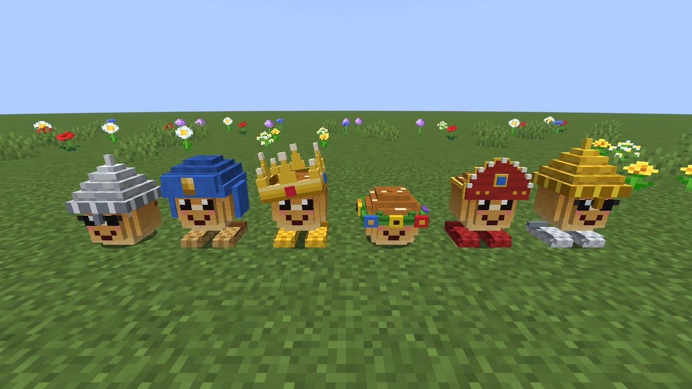
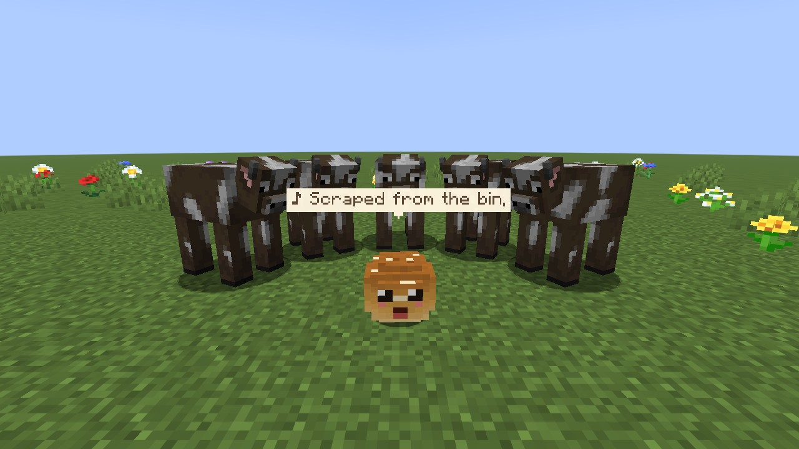
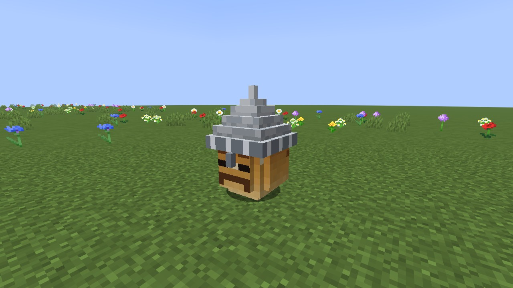
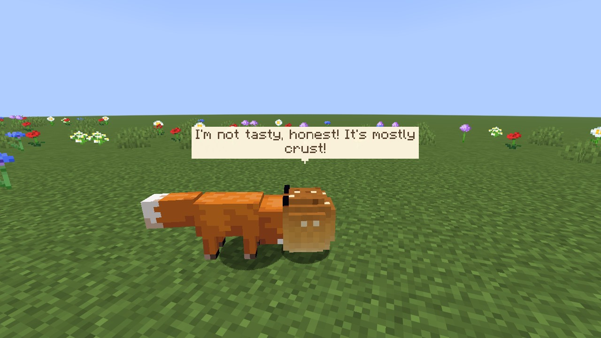
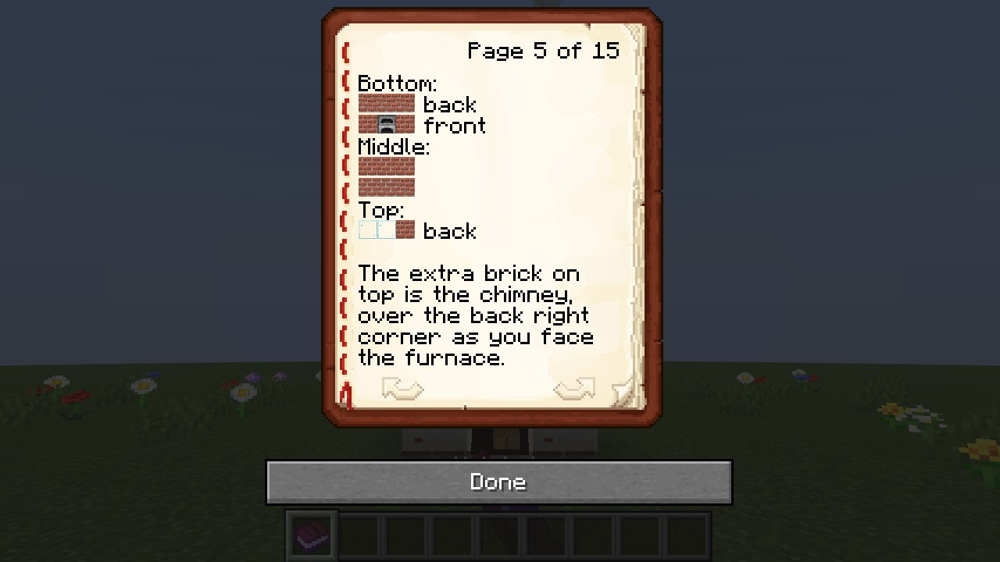
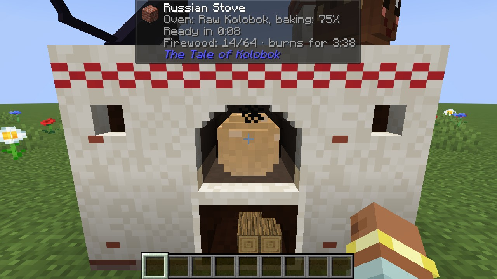

# Kolobok


A Minecraft mod about Kolobok, the round loaf from the Russian fairy tale who rolled away from grandma and grandpa, the hare, the wolf and the bear, singing his song as he went. Here you bake him yourself in a Russian stove, win him over by hearing his song out, and take him along: he rides on your shoulder, sings, jokes, gets into trouble and runs from everyone who wants to eat him. Mind the fox.

For Minecraft 26.3 on NeoForge and Fabric. English and Russian.



## Features

- **Baked, not found.** Kolobki never spawn in the world. Build a Russian stove from a furnace and 12 bricks with grandma's rolling pin, knead the dough at the crafting table, light the stove with flint and steel and put a raw Kolobok into the oven. Five kinds of dough: wheat, Borodinsky rye, golden, lunar (bake on a full moon night) and the little Kolobochek.
- **The stove** has a wood store for logs and an oven chamber you can see into. It burns log after log, cooks anything a smoker does a whole stack at a time, and a warm stove heals a hurt Kolobok resting on top. Cats like it too.
- **Taming by listening.** A freshly baked Kolobok cools down, jumps out and rolls away singing. Crouch close and stay still to the end of his verse, then offer him a bucket of milk.
- **His song.** A children's song in 2/4 with a melody of its own, sung in the syllables of real Russian words whatever the game language; the speech bubble shows the line in yours.
- **Verses and perks.** Every mob he gets away from adds a verse to his song and teaches him something: a hare makes him faster, a creeper makes explosions harmless, a spider lets him climb walls, sixteen verse perks in all. The songbook writes down his song and perks.
- **A companion.** He follows you, sits, keeps guard or wanders, climbs onto your shoulder, where he watches your back for creepers and skeletons, or onto your head, where he takes a falling anvil for you, and talks in speech bubbles. His jokes were written separately in English and in Russian, not translated.
- **The fox** hunts him and carries him off in its teeth. Throw it some berries.
- **Outfits.** Any helmet becomes a bogatyr's helmet or an ushanka on him, boots become bast shoes, tinted glass becomes sunglasses, and he has a crown, a wreath and a kokoshnik of his own, which you can wear too. Sometimes, asleep in a metal helmet, he dreams he is the giant Head from Pushkin's «Ruslan and Ludmila». Tickle him with a feather: he squeaks, and the Head sneezes.
- **Skills.** Carry him in a bindle, call him with a goat horn, bowl mobs over with him, let him fill his cheeks with loot and bring it home, follow his bread crumbs back, pay an emerald for the way to a village. And the chicken jockey.
- **Care.** Milk and honey keep him fresh; without them he goes stale. Rain makes him soggy, fire gives him a tan. Death is final, so look after him. While you are away from the server he dozes and keeps to himself, though he still runs from danger.
- **27 advancements** in a tab of their own, «The Tale of Kolobok», with a `kolobok:tale` criterion trigger for data packs.
- **A guide book**, «How to Bake a Kolobok», for every player on first joining: just what you would hardly work out alone, the stove's layout included. Lost it? A book and a brick make another.

## Screenshots

| | |
|---|---|
|  |  |
| The Russian stove | On your shoulder, on your head |
|  |  |
| Outfits | A concert |
|  |  |
| The Head | The fox |
|  |  |
| The guide book | With Jade |

## Getting started

1. **Rolling pin**: a stick, planks and a stick in a row.
2. **Stove**: lay out a furnace and bricks as below, then Shift-right-click the furnace with the rolling pin.

   ```text
   bottom layer:  back  [B][B][B]     middle layer:  [B][B][B]     on top:  [ ][ ][B]
                  front [B][F][B]                    [B][B][B]
   ```

   F is the furnace, B a brick. The single brick on top, over the back right corner as you face the furnace, becomes the chimney.
3. **Dough**: three wheat, an egg and a milk bucket at the crafting table; add cocoa beans for Borodinsky, a gold ingot for golden, or use a single wheat for the little Kolobochek. Dough and the rolling pin make a raw Kolobok.
4. **Baking**: right-click the stove with logs to fill the wood store, light it with flint and steel, and right-click with the raw Kolobok to put him into the oven. He is done in 30 seconds and cools for two minutes, or for 30 seconds with glass by the stove as a window.
5. **Taming**: when he rolls away singing, crouch near him without moving until his verse ends, then give him a milk bucket. No luck? Listen to another song.

Everything else is in the guide book.

## Controls

| Action | What happens |
|---|---|
| Right-click with an empty hand | sit, or follow you |
| Shift-right-click with an empty hand | onto your shoulder, then onto your head, then down; a hungry owner (food at 6 or less) bites a sitting one instead |
| Press Shift twice quickly | get him off your shoulder or head; he will not jump where he would break, as off a cliff or while you glide |
| Right-click with the rolling pin | switch mode: follow, follow dropping crumbs, guard, wander |
| Right-click the air with the rolling pin | bowling: your nearest Kolobok rolls where you look |
| Shift-right-click with the rolling pin | he spits out what is in his cheeks |
| Right-click with a milk bucket | heal and freshen him; tame a wild one whose song you heard out |
| Right-click with a honey bottle | heal and freshen him; you keep the bottle |
| Right-click with the songbook | he writes down his song and perks |
| Right-click with a helmet, boots, the crown, wreath, kokoshnik or tinted glass | dress him; what he wore comes back to you |
| Right-click with shears | take things off one at a time |
| Right-click with an empty bindle | he climbs in; right-click a block to let him out |
| Blow a goat horn | all your Kolobki within 64 blocks come to you |
| Right-click with an emerald | he shows the way to the nearest village, once a game day |
| Right-click with a feather | tickle him |
| Right-click the stove with an empty hand | take out what is in the oven; with anything it does not take, see what is in it |
| Shift-right-click the stove with both hands empty | take the logs back |

He sits on one player at a time, and a player carries one Kolobok: another one will not climb on, he takes offence. On your shoulder or head he goes with you wherever you go, through portals and teleports included; on his own he never steps into a portal. In water, lava or any other fluid he jumps off at once.

## Mod integrations

All optional; Kolobok runs without any of them.

- **[Jade](https://modrinth.com/mod/jade)**: look at any block of the stove to see what is in the oven and when it is done, the wood and how long it will last, whether the stove is too hot, still warm or has a window; the stove then draws no labels of its own. Look at a Kolobok to see his dough, what he is doing, whether he sings, his crust and his verses, and his perks with Jade's details key. Works on servers without Jade.
- **[JEI](https://modrinth.com/mod/jei)** and **[REI](https://modrinth.com/mod/rei)**: a Russian stove recipe category (every dough, the logs, the time, and the lunar Kolobok of a full moon night), the guide book's recipe, and hint pages on the mod's items.
- **[Modonomicon](https://modrinth.com/mod/modonomicon)**: the guide book becomes a Modonomicon book with the same texts and the stove in 3D, which you can project onto the world to build it.

EMI and Patchouli have no build for 26.3 yet.

## Configuration

Both files are created in `config/kolobok/` on first launch; new settings are added to old files without touching your values.

`client.json`: how many internet memes his lines may have (`memeLevel`), how chatty he is (`chattiness`), where his lines show (`speech`: bubbles, chat or both; only your own Kolobki write in chat, anyone else's talk in bubbles), his voice volume (`voiceVolume`), and whether to show his bread crumbs (`crumbs`).

`server.json`: the taming chance (`tameChanceDenominator`), and switches for foxes hunting him (`foxHunting`), running off to sing to animals (`escapades`), drawing mobs off his owner (`luring`), a song annoying mobs nearby (`annoyingSong`), biting him (`biting`), the chicken jockey (`chickenJockey`), the beetroot bonus (`repka`), days until he goes stale (`staleDays`), how far the way to a village is searched (`guideSearchChunks`) and the guide book on first joining (`guideBook`).

## Installation

- Minecraft 26.3.
- NeoForge 26.3.0.85 or newer, or Fabric Loader 0.20.0 or newer with [Fabric API](https://modrinth.com/mod/fabric-api).
- Install the mod on the server and on every client. NeoForge and Fabric each have their own jar: `kolobok-neoforge-26.3-<version>.jar` and `kolobok-fabric-26.3-<version>.jar`.

## Contributing

Ideas, wishes and bug reports are welcome as issues. Fixes, translations and additions are welcome as pull requests; I review every one before it is merged. For a bigger change, open an issue first so we can agree on it.

To build from source you need JDK 25:

```sh
./gradlew build          # both jars, in versions/26.3-neoforge/build/libs and versions/26.3-fabric/build/libs
./gradlew test           # unit tests
./gradlew :26.3-fabric:runClientGameTest   # a real client walks through scripted scenes and saves screenshots
./gradlew :26.3-neoforge:runClient          # or :26.3-fabric:runClient
```

The project is one source tree for both loaders, built with [Stonecutter](https://stonecutter.kikugie.dev/); loader-specific code lives only in `platform/fabric` and `platform/neoforge`. The textures, the voice and the stove's models are generated by the scripts in `tools/`.

## License

[MIT](LICENSE).
